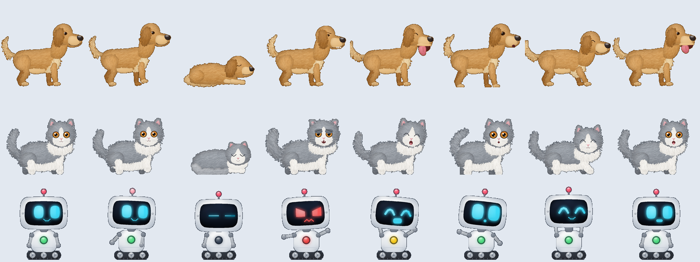
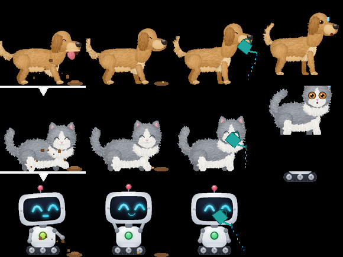
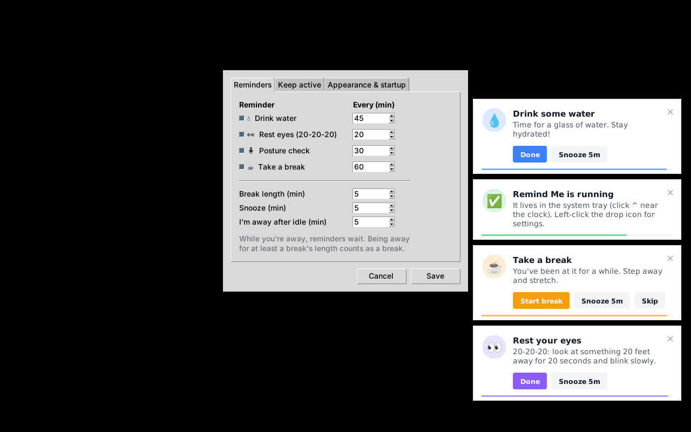

# Remind Me 💧

**A friendly Windows desktop companion that reminds you to drink water, rest your eyes, fix your posture and take breaks, delivered by an animated desktop pet that walks around your screen.**




---

## ✨ Features

### Wellness reminders
| Reminder | Default |
|---|---|
| 💧 Drink water | every 45 min |
| 👀 Rest your eyes (20-20-20 rule) | every 20 min |
| 🧍 Posture check | every 30 min |
| ☕ Take a break | 5 min break every 60 min |

- Every reminder has **Done** and **Snooze** buttons. Breaks come with a live countdown.
- **Away detection:** when you're away from the PC, reminders wait instead of piling up. Being away for at least a break's length counts as your break.
- Pause reminders for 30 minutes, 1 hour, 2 hours, or until you resume.

### Desktop pet
Choose **Buddy** (Golden Retriever), **Mochi** (grey-and-white Persian cat) or **Bolt** (robot).

| You do | The pet does |
|---|---|
| Nothing | Walks around, looks about, takes naps |
| Reminder is due | Says it in a speech bubble and **reads it aloud** with a Windows voice |
| Click it | Gets angry, and angrier if you keep going |
| Wiggle the mouse over it | Laughs: it's ticklish |
| Drag & drop | Picks it up and puts it where you drop it |
| Leave your PC | Falls asleep and wakes up happy when you return |
| Click **Done** on water | Drinks with you 🥤 |
| Turn on follow mode | Walks beside your mouse pointer |
| Right-click it | Opens a menu: change avatar, follow mouse, gravity, garden, voice, hide |

### 🌱 Gravity mode and taskbar garden
In gravity mode the pet lives on top of your taskbar. If you drop it mid-screen, it falls back down. Every so often it **digs a hole, plants a seed and waters it**. Each watering makes a plant grow a stage: sprout → young plant → bud → flower.



### Bring your own avatar
Drop a folder of transparent PNG frames into `assets/avatars/` and it appears in Settings. See [Custom avatars](#-custom-avatars-png-sprite-packs).

### Keep PC active (optional)
When you're idle, it can nudge the mouse a pixel and put it back, so your PC doesn't lock or sleep. It never moves the pointer while you're using it. The settings are tucked away behind the small **⚙** icon in the Settings window.

> ⚠️ On work computers, check that your IT policy allows keep-awake tools.

---

## 🚀 Getting started

### Requirements
- Windows 10 or 11
- Python 3.10+ ([python.org](https://www.python.org/downloads/)). It works with either the `py` launcher or `python` on PATH.

### Run from source
```bat
git clone https://github.com/YOUR-USERNAME/remind-me.git
cd remind-me
run.bat
```
`run.bat` installs the two dependencies (`pystray`, `Pillow`) and starts the app with no console window. Look for the blue water-drop icon in the system tray. If you don't see it, click `^` next to the clock.

Manual alternative:
```bat
py -m pip install -r requirements.txt
pyw run.pyw
```

### Build a standalone .exe
```bat
build.bat
```
This produces `dist\RemindMe.exe`, which doesn't need Python.

---

## 🖱️ Using it

- **Left-click** the tray icon to open **Settings**. **Right-click** it to open the menu: remind me now, pause or resume, show the avatar, follow mouse, gravity, quit.
- Settings has these tabs:
  - **Reminders:** intervals, break length, snooze, away threshold
  - **Avatar:** which pet, size, walking, follow mouse, gravity, garden, voice, speed and volume
  - **Appearance & startup:** toast position, light or dark theme, sound, start with Windows
  - **⚙ (bottom-left):** shows the hidden *Keep active* tab
- With the avatar hidden, reminders show as corner toasts:



### Voices
Speech uses the voices built into Windows (`System.Speech`, such as Microsoft David and Zira), so it works offline. You can pick a voice, speed and volume under **Settings → Avatar**. Some voices installed through *Windows Settings → Speech*, including the newer "Natural" voices, may not show up in the list.

---

## 🎨 Custom avatars (PNG sprite packs)

1. Copy `assets/avatars/_template` and rename the copy, for example to `assets/avatars/rex`.
2. Add transparent PNG frames: `idle_01.png`, `walk_01.png` … `walk_08.png`, `sleep_01.png`, and so on.
   Only **idle** is required. Missing states fall back to other frames (laugh → happy → idle).
3. Edit `avatar.json`: name, facing direction, fps, the file pattern for each state, and optionally custom lines.
4. Restart the app and pick your avatar in **Settings → Avatar**.

You can also put packs in `%APPDATA%\RemindMe\avatars\`. The template's `README.txt` documents every field.
Please only share art you made or have a licence to distribute.

---

## 🗂️ Where things are stored

| What | Where |
|---|---|
| Settings, garden, pet position | `%APPDATA%\RemindMe\config.json` |
| Log (for bug reports) | `%APPDATA%\RemindMe\remindme.log` |
| Rendered avatar frames (cache) | `%APPDATA%\RemindMe\cache\` |
| Start with Windows | `HKCU\Software\Microsoft\Windows\CurrentVersion\Run` → `RemindMe` |

To reset everything, quit the app and delete `%APPDATA%\RemindMe`.

---

## 🧱 Project structure

```
remind-me/
├── run.pyw / run.bat        # start the app (no console)
├── build.bat                # build dist\RemindMe.exe with PyInstaller
├── remindme/
│   ├── app.py               # scheduler, idle/away tracking, glue
│   ├── config.py            # defaults + load/save config.json
│   ├── winapi.py            # ctypes: idle time, mouse nudge, topmost, DPI, startup
│   ├── toast.py             # corner toast notifications
│   ├── tray.py              # system tray icon + menu (pystray)
│   ├── settings_window.py   # Tk/ttk settings dialog
│   ├── voice.py             # text-to-speech via Windows System.Speech
│   └── pet/
│       ├── pet.py           # pet window, behaviour state machine, mouse, gravity, jobs
│       ├── bubble.py        # speech bubble with buttons
│       ├── garden.py        # taskbar plants
│       ├── art.py           # Pillow painting toolkit (shading, fur, glow)
│       ├── illustrated.py   # image-based avatar base + frame cache
│       ├── dog.py / cat.py / robot.py   # the built-in avatars
│       ├── sprites.py       # PNG sprite-pack loader
│       ├── base.py          # avatar base class, phrases, effects
│       ├── painter.py       # coordinate helpers for canvas drawing
│       └── avatars.py       # avatar registry
├── assets/avatars/_template # sprite-pack template
└── docs/images              # screenshots for this README
```

---

## 🤝 Contributing

Contributions are welcome, especially new avatars, more languages and bug fixes. See [CONTRIBUTING.md](CONTRIBUTING.md).

## 📄 License

[MIT](LICENSE) © 2026 Ajay B

All avatars (Buddy, Mochi, Bolt) are original artwork drawn in code for this project. Remind Me isn't affiliated with any robot, toy or pet brand.
